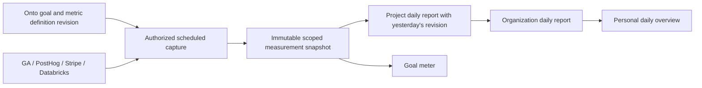

# Goal measurement snapshots — proposed integration

Status: design and type stubs only. No credentials, provider calls, schedules, storage migrations, or canonical goal changes are enabled by the project preview.

## Reuse what exists

Onto owns goal and metric definitions. The SDK's `graph-contracts/ontology-measures.ts` already describes declared measures, units, and formula fields; it validates definitions, not provider observations. Planning's `personal-goal-context.ts` correctly leaves progress unknown when only definitions are available. Preserve both contracts. The new `server/measurement-snapshot.ts` describes the missing observation boundary rather than replacing definitions.

## Capture once, reference in reports

A snapshot binds owner, project, metric definition revision, connection, query revision, timezone and half-open measurement window to a capture time, unit, audience, completeness and evidence references. Report and meter must use the same snapshot. Distinguish event time/window from capture time. Persist through an app-owned entity contract and reference snapshots from Wiki reports; choose the canonical storage owner before adding migrations. Never put credentials or raw personal event payloads in Wiki reports.

Provider adapters must recheck owner authorization and connection access, use parameterized scoped queries, and define deduplication grain, aggregation, attribution and freshness. Retries should reuse a stable capture key derived from owner, metric revision, query revision, window and audience; corrections become new revisions. Zero requires a complete successful query; missing, stale, revoked or partial data stays unknown. Historic reports pin snapshot revisions.

| Source | First useful observation | Does not establish |
| --- | --- | --- |
| Google Analytics | Attributed external sessions reaching a landing or checkout page | Payment or successful installation |
| PostHog | A verified journey, onboarding event, or active-device/plant observation | Paid orders from a click event |
| Stripe | Confirmed live customer payment/order, with explicit refund/cancellation policy | All sessions that considered purchasing |
| Databricks | Versioned aggregate query over an agreed dataset and identity grain | Current completeness without watermark/freshness checks |

## Checkpoints and outcomes

The first observed team run can satisfy a checkpoint. Customer adoption requires external-customer observations and must exclude team, test-mode, bot and duplicate activity. A checkout redirect is not a payment. Proposed targets need an explicit unit, window, audience and success rule; targets are not observations. Keep checkout handoff, onboarding, active plants, and paid orders separate even when they belong to the same journey.

## Follow-up inventory and evals

- Implement one provider adapter after validating the relevant authorized connection and metric definition.
- Define snapshot publication, idempotency, correction and retention contracts; no page-load capture.
- Add observed/unknown/partial/stale UI states and last-observed time; no invented meter percentages.
- Eval complete zero versus unavailable, internal tests versus customers, duplicate events, late/refunded payments, timezone boundaries, stale windows, revoked access and cross-owner isolation.
- Add prior-report continuity to generation, then evaluate project → organization → personal rollups against pinned source revisions. The separate `daily-report-evals` worktree inventories the existing chain and its gaps; its synthetic metric grader is not a live integration.
