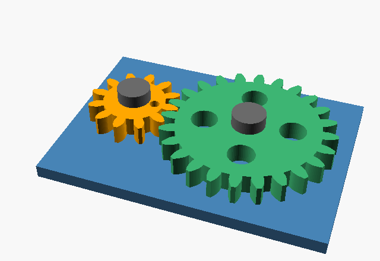

# Gear pair: two parts that drive each other

Tier 3 of [docs/vision.md](../../docs/vision.md). Persona: a robotics team making its first drive train, a 2:1 reduction whose teeth never collide while it turns.

A base with two axle posts and two spur gears that mesh: a 12-tooth gear that drives a 24-tooth gear the other way at half speed (2:1). Both gears are module 2 with a 20° pressure angle, and their centres are 36 mm apart. A press-fit cap holds each gear on its post.



| Part | File | Qty | Print |
| --- | --- | --- | --- |
| Base | `base.stl` | 1 | Base down |
| Small gear (12 teeth) | `small.stl` | 1 | Flat |
| Large gear (24 teeth) | `large.stl` | 1 | Flat |
| Cap | `cap.stl` | 2 | Already flipped, flat face down |

Fit: each tooth is thinned 0.15 mm (backlash) so the gears don't bind, and the bores have 0.3 mm radial clearance on the 6 mm posts. Caps press onto 4 mm pegs.

Collision check: the `interference` part is the overlap between the gears, and between each gear and the base, at rotation `$t`. It is empty at every step through one full tooth of rotation, and the mesh repeats every tooth. With fattened teeth (`-D backlash=-0.6`) it isn't empty, so the check does catch collisions.

```sh
for p in base small large cap; do openscad -D "part=\"$p\"" -o $p.stl gears.scad; done
openscad -D 'part="interference"' -D '$t=0.02' -o check.stl gears.scad   # "top level object is empty" = no collision
openscad -D 'part="assembly"' -D from_stl=true -D '$t=0.25' -o frame.png gears.scad
```

OpenSCAD 2021's `--animate` crashed under a virtual display partway through, so the GIF was made by rendering one PNG per `$t` and joining them with ffmpeg.
