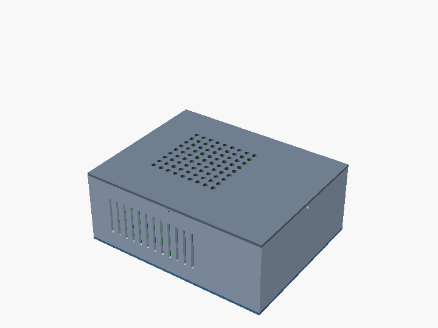

# Mini-ITX case

Tier 2 of [docs/vision.md](../../docs/vision.md). Persona: a home-lab builder who wants a small printed case for a Mini-ITX board and a Flex ATX power supply, and needs the board holes, the I/O shield and the power inlet to line up before printing 300 g of plastic.

Three printed parts around three purchased ones. The purchased parts are envelopes from their specifications, not manufacturer models: the board is 170 x 170 mm with the ATX mounting holes C, F, H and J, the cooler is a 95 x 95 x 37 mm block, and the power supply is a 40 x 150 x 81.5 mm Flex ATX unit standing on its long edge with an IEC inlet at the back.



| Part | File | Qty | Print |
| --- | --- | --- | --- |
| Base with standoff bosses and PSU stops | `base.stl` | 1 | Flat |
| Shell: four walls, I/O and PSU openings, vent slots | `shell.stl` | 1 | Upright; 224 x 178 mm footprint, or print as two halves |
| Top with lip and vent grid | `top.stl` | 1 | Already flipped, lip up (`part="top-design"` renders it as designed) |

Outside 224 x 178 x 89 mm. Every part is boxes and cylinders, at most 45 features, so each is a Workshop CAD plan; the `case-*` fixtures in `agent-evals/evals/` ask a model for them one at a time, and `tests/box-geometry.unit.test.ts` holds a plan for each that passes its eval. The top's lip drops inside the shell with 0.2 mm a side and takes four M3 screws through the walls. `bom.csv` lists the printed and purchased parts; `request.json` is the design request a Workshop agent would receive for this part.

## Fit checks

Each check renders a solid that must come out empty ("Current top level object is empty"):

- `interference`: overlap between the printed parts, and between each printed part and each purchased envelope. Parts that rest on another are lifted 0.01 mm so face contact does not count.
- `standoff-fit`: the board's holes less the bosses under them. Moving the board 3 mm (`-D 'board_offset=[3,0]'`) makes it fail.
- `io-fit`: the rear connectors against the back wall. Raising the aperture 27 mm (`-D io_z=40`) makes it fail.
- `pair`: the overlap between any two parts by name, for finding which pair collides.

```sh
for p in base shell top; do openscad -D "part=\"$p\"" -o $p.stl case.scad; done
for c in interference standoff-fit io-fit; do openscad -D "part=\"$c\"" -o check.stl case.scad; done
openscad -D 'part="pair"' -D 'pair=["shell","psu"]' -o check.stl case.scad
openscad -D 'part="assembly"' -D '$t=0.5' -o frame.png case.scad   # $t from 0 to 1 explodes the view
```

## What this shows about Workshop

Workshop's assembly model can already hold these items and their positions. What it cannot do yet is what this example needs: a design agent that lays out purchased envelopes and designs the printed parts around them, mounting patterns carried by the envelope (the board's hole pattern, the inlet on the power supply) so the fit checks come from the data instead of being written by hand, and an eval that runs these checks on the agent's output.
