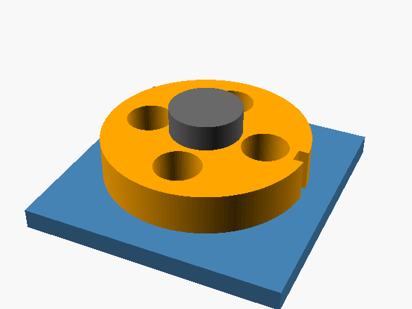

# Spinning wheel: first moving assembly

Three printed parts: a stand with an 8 mm axle, a 40 mm wheel that spins on it, and a cap that presses onto the axle's 5 mm peg to keep the wheel on.



| Part | File | Print |
| --- | --- | --- |
| Stand | `stand.stl` | Base down |
| Wheel | `wheel.stl` | Flat |
| Cap | `cap.stl` | Already flipped, flat face down |

Fit: the wheel bore has 0.3 mm radial clearance on the axle, and the wheel sits on a 1 mm shoulder so it doesn't rub the base. The cap hole is nominal size, so the cap presses on because FDM holes print slightly small. Add a drop of glue if it's loose.

Rebuild everything from `spinner.scad`:

```sh
for p in stand wheel cap; do openscad -D "part=\"$p\"" -o $p.stl spinner.scad; done
openscad -D 'part="interference"' -o check.stl spinner.scad   # "top level object is empty" = no parts overlap
openscad -D 'part="assembly"' -D '$t=0.25' -o frame.png spinner.scad   # $t from 0 to 1 is one turn
```
